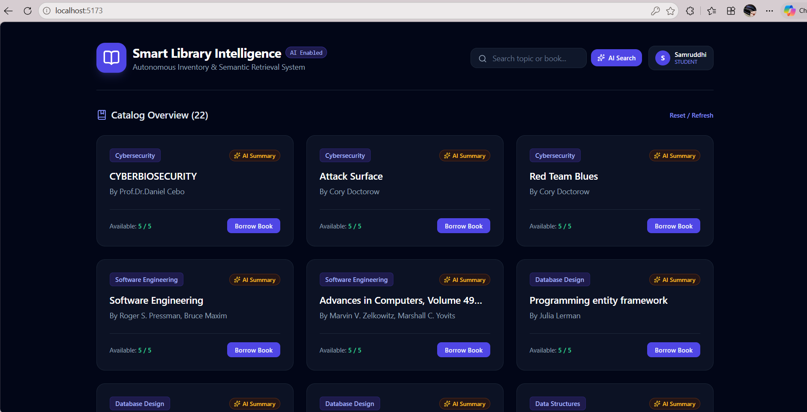
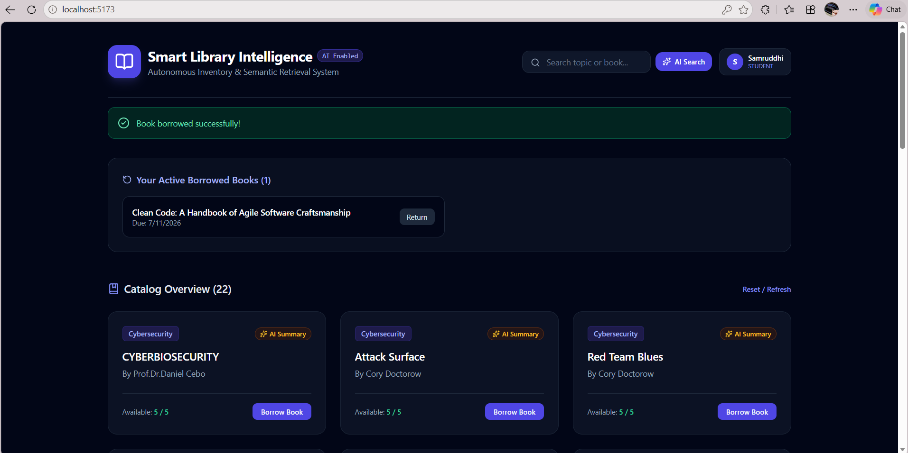
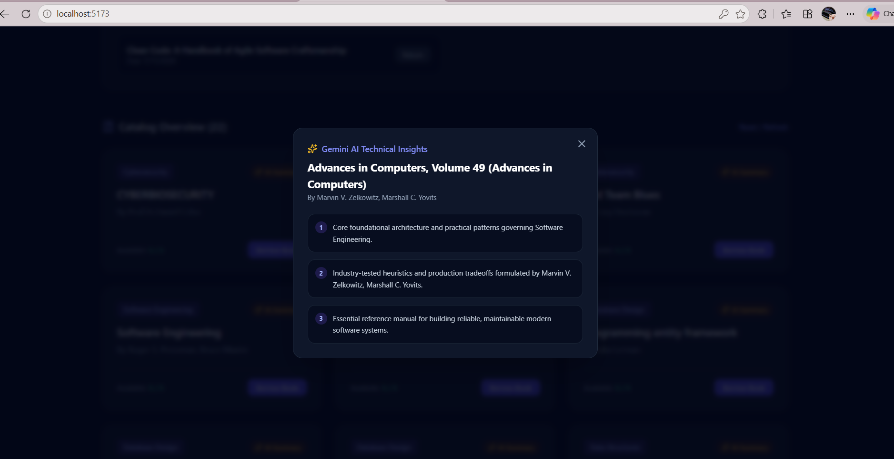

# 📚 Smart Library Intelligence System

> An autonomous inventory management and semantic retrieval system powered by Google Gemini AI, PostgreSQL (Supabase), Prisma ORM, and React.

---

## 🚀 Features

- **Semantic AI Search**: Query books using natural language intent (e.g., *"books about distributed systems architecture"*) instead of exact keyword matching.
- **On-Demand Technical Summaries**: Instant 3-bullet technical takeaways synthesized for each book using Google Gemini.
- **Automated Catalog Ingestion**: Scripted ingestion using the Open Library API to batch-seed realistic engineering textbooks without manual entry.
- **Borrow & Return Lifecycle**: Atomic database transactions ensuring real-time inventory tracking and concurrency protection.
- **Student Authentication**: Secure sign-up/sign-in with JWT session tokens and personal loan shelves.

## 📸 Application Preview

| Main Catalog & Profile | Active Loans & Real-Time Return |
| :---: | :---: |
|  |  |

<p align="center">
  <b>⚡ Gemini AI Technical Insights Modal</b><br>
  
</p>

---

## 🛠️ Tech Stack

- **Frontend**: Vite, React, Tailwind CSS, Lucide Icons, Axios
- **Backend**: Node.js, Express.js
- **Database**: PostgreSQL (Supabase), Prisma ORM
- **AI Engine**: Google Gemini API (`@google/genai`)
- **Authentication**: JSON Web Tokens (JWT), bcryptjs

---

## 📁 Project Structure

```text
smart-library-intelligence-system/
├── client/                 # React frontend application
│   ├── src/
│   │   ├── App.jsx         # Primary library dashboard & modals
│   │   ├── main.jsx
│   │   └── index.css
│   └── package.json
├── server/                 # Express API server & database scripts
│   ├── prisma/
│   │   ├── schema.prisma   # Prisma schema definitions
│   │   └── autoSeed.js     # Open Library API batch seeder
│   ├── src/
│   │   ├── aiRoutes.js     # Gemini AI summarization & semantic search
│   │   ├── authRoutes.js   # User registration & JWT authentication
│   │   ├── bookRoutes.js   # Book catalog endpoints
│   │   ├── borrowRoutes.js # Borrow & return transaction logic
│   │   └── db.js           # Prisma client instance
│   ├── index.js            # Express server entry point
│   └── package.json
└── README.md

Here is a clean, comprehensive **`README.md`** template tailored specifically for your project.

Replace the contents of `README.md` in the root of your project:

```markdown
# 📚 Smart Library Intelligence System

> An autonomous inventory management and semantic retrieval system powered by Google Gemini AI, PostgreSQL (Supabase), Prisma ORM, and React.

---

## 🚀 Features

- **Semantic AI Search**: Query books using natural language intent (e.g., *"books about distributed systems architecture"*) instead of exact keyword matching.
- **On-Demand Technical Summaries**: Instant 3-bullet technical takeaways synthesized for each book using Google Gemini.
- **Automated Catalog Ingestion**: Scripted ingestion using the Open Library API to batch-seed realistic engineering textbooks without manual entry.
- **Borrow & Return Lifecycle**: Atomic database transactions ensuring real-time inventory tracking and concurrency protection.
- **Student Authentication**: Secure sign-up/sign-in with JWT session tokens and personal loan shelves.

---

## 🛠️ Tech Stack

- **Frontend**: Vite, React, Tailwind CSS, Lucide Icons, Axios
- **Backend**: Node.js, Express.js
- **Database**: PostgreSQL (Supabase), Prisma ORM
- **AI Engine**: Google Gemini API (`@google/genai`)
- **Authentication**: JSON Web Tokens (JWT), bcryptjs

---

## 📁 Project Structure

```text
smart-library-intelligence-system/
├── client/                 # React frontend application
│   ├── src/
│   │   ├── App.jsx         # Primary library dashboard & modals
│   │   ├── main.jsx
│   │   └── index.css
│   └── package.json
├── server/                 # Express API server & database scripts
│   ├── prisma/
│   │   ├── schema.prisma   # Prisma schema definitions
│   │   └── autoSeed.js     # Open Library API batch seeder
│   ├── src/
│   │   ├── aiRoutes.js     # Gemini AI summarization & semantic search
│   │   ├── authRoutes.js   # User registration & JWT authentication
│   │   ├── bookRoutes.js   # Book catalog endpoints
│   │   ├── borrowRoutes.js # Borrow & return transaction logic
│   │   └── db.js           # Prisma client instance
│   ├── index.js            # Express server entry point
│   └── package.json
└── README.md

```

---

## ⚙️ Setup & Installation

### 1. Clone the Repository

```bash
git clone [https://github.com/samruddhiii012/smart-library-intelligence-system.git](https://github.com/samruddhiii012/smart-library-intelligence-system.git)
cd smart-library-intelligence-system

```

### 2. Configure Backend

```bash
cd server
npm install

```

Create a `.env` file inside `server/` with:

```env
PORT=5000
DATABASE_URL="your_supabase_postgresql_connection_string"
DIRECT_URL="your_supabase_direct_url"
GEMINI_API_KEY="your_gemini_api_key"
JWT_SECRET="your_jwt_secret_key"

```

Sync database schema and optionally run the automated seeder:

```bash
npx prisma db push
node prisma/autoSeed.js

```

Start the backend server:

```bash
npm run dev

```

### 3. Configure Frontend

Open a new terminal window:

```bash
cd client
npm install
npm run dev

```

The application will be running locally at `http://localhost:5173`.

---

## 📄 License

This project is open-source and available under the MIT License.

```

---

### Push the Updated README to GitHub

Once you paste and save the file in `README.md`, run these commands in your project root terminal:

```powershell
git add README.md
git commit -m "docs: add comprehensive project documentation and setup guide"
git push

```